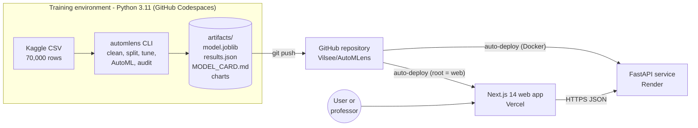
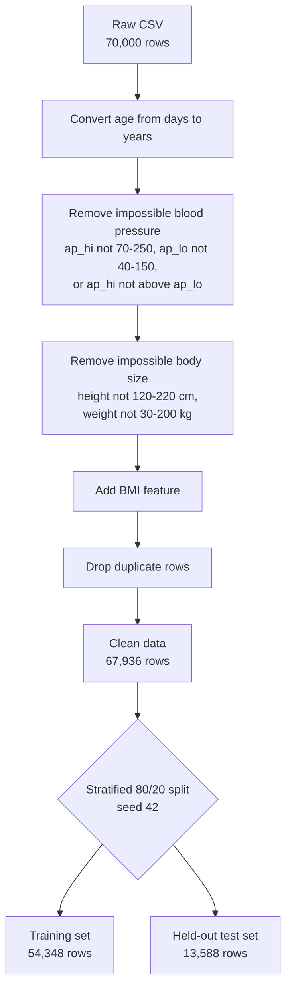
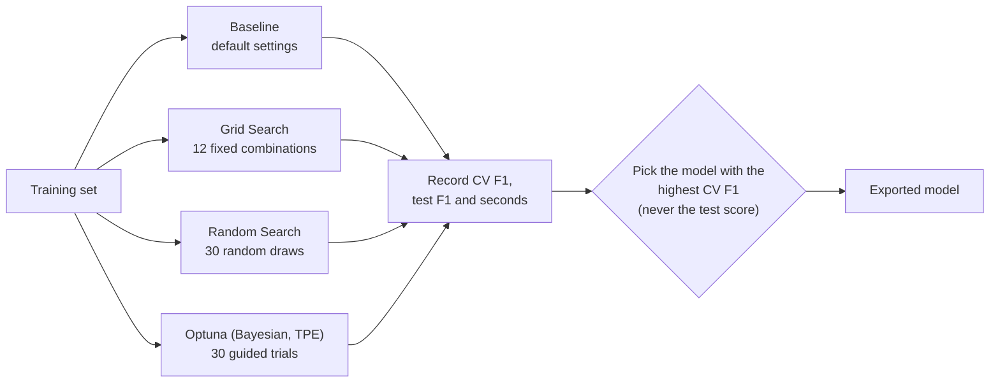
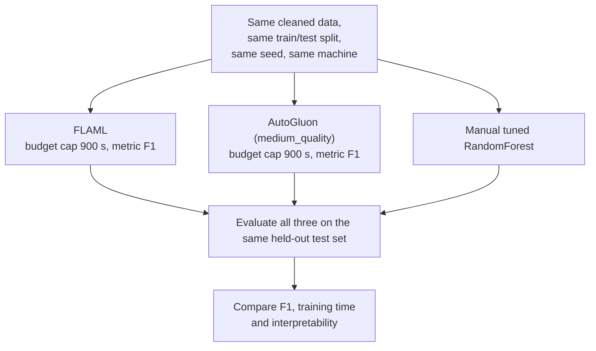
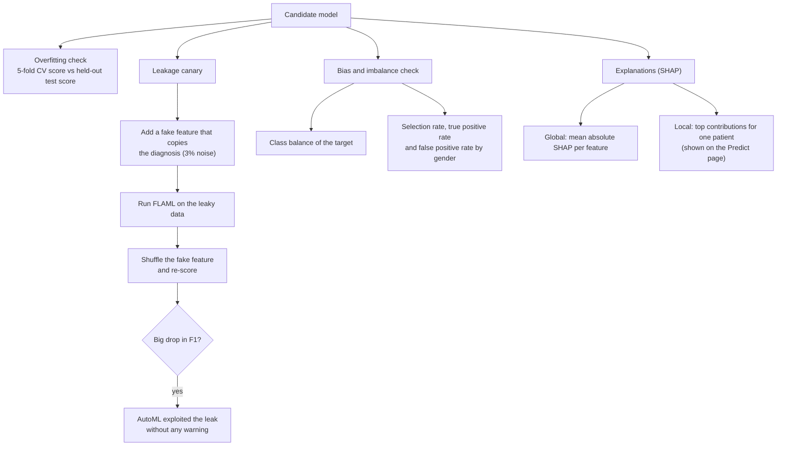
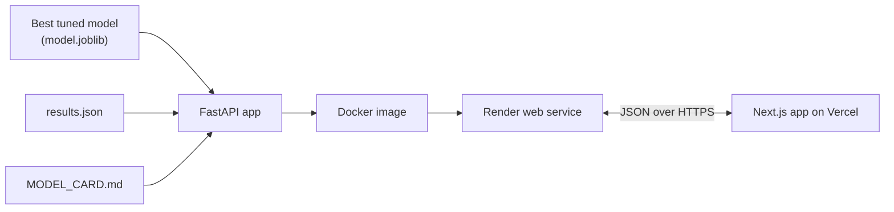
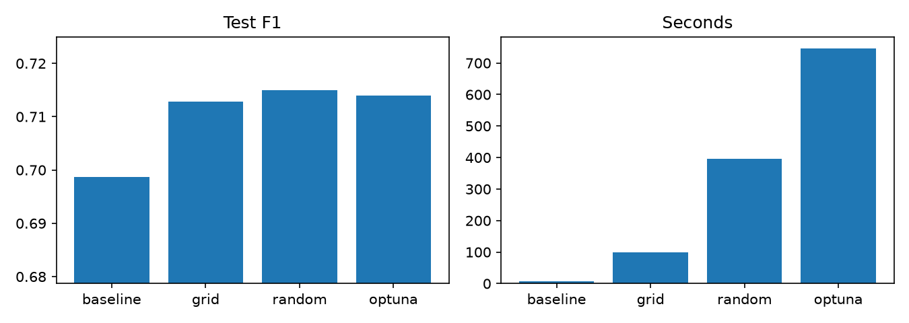
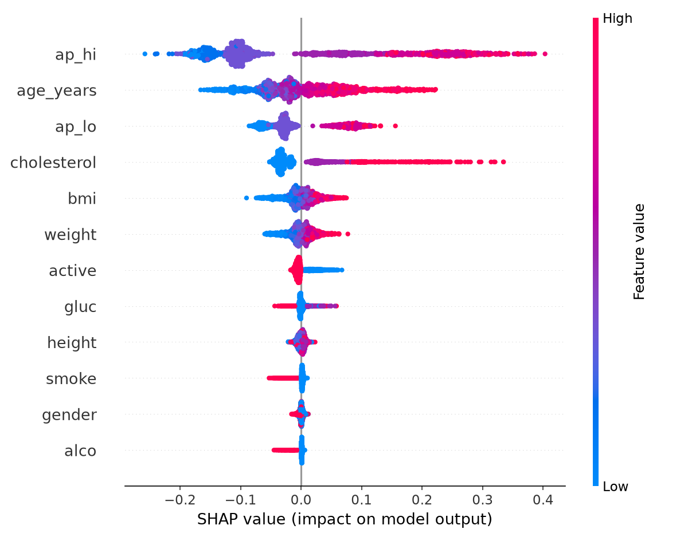
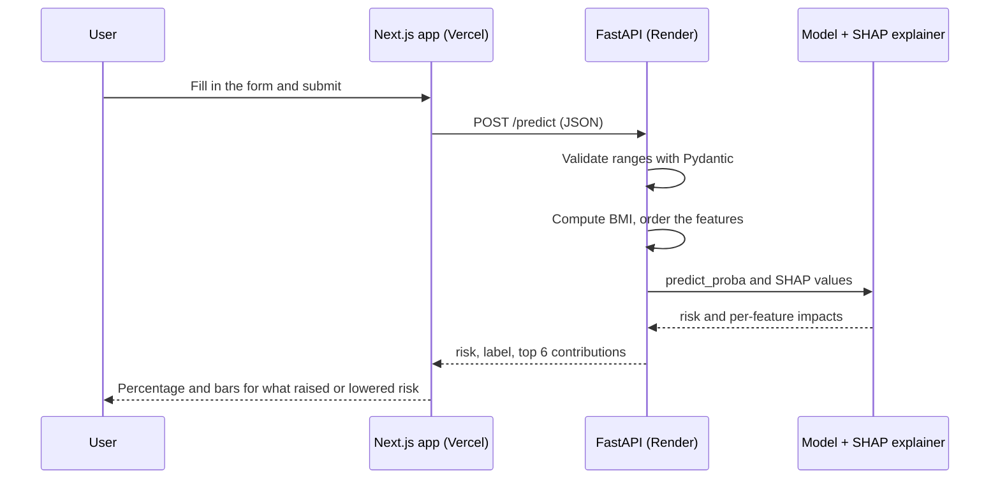
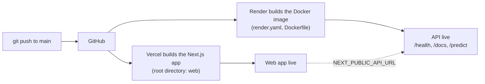

# AutoMLens

**An audited AutoML workflow for clinical tabular data: tuning, two AutoML tools, leakage and bias checks, explanations, a model card, and a live prediction demo.**


> **Educational project. Not a medical device and not for diagnosis or treatment decisions.**

---

## Live links

| What | Link |
|---|---|
| Live web app (Vercel) | https://auto-m-lens.vercel.app |
| API documentation, try it in the browser (Swagger) | https://automlens-api.onrender.com/docs |
| API health check | https://automlens-api.onrender.com/health |
| Model card (served by the API) | https://automlens-api.onrender.com/model-card |
| All results as JSON | https://automlens-api.onrender.com/leaderboard |
| Source code (this repository) | https://github.com/Vilsee/AutoMLens |
| Dataset (Kaggle) | https://www.kaggle.com/datasets/sulianova/cardiovascular-disease-dataset |

> The API runs on Render's free tier and goes to sleep when idle. The first request after a pause can take up to a minute. Open the health link a couple of minutes before a demo.


---

## Table of contents

1. [Why this project](#1-why-this-project)
2. [Assignment requirements and where to find each one](#2-assignment-requirements-and-where-to-find-each-one)
3. [System architecture](#3-system-architecture)
4. [Dataset and cleaning](#4-dataset-and-cleaning)
5. [Method, step by step](#5-method-step-by-step)
6. [Results](#6-results)
7. [Key findings](#7-key-findings)
8. [API reference](#8-api-reference)
9. [Web application](#9-web-application)
10. [Deployment and automation](#10-deployment-and-automation)
11. [Repository structure](#11-repository-structure)
12. [Run it yourself](#12-run-it-yourself)
13. [Design decisions, limitations and ethics](#13-design-decisions-limitations-and-ethics)
14. [Presenting this project](#14-presenting-this-project)
15. [References and tools](#15-references-and-tools)

---

## 1. Why this project

AutoML tools make it easy to get a high score, and just as easy to trust it without checking. In healthcare that is risky: a model that quietly uses a feature it will not have in real use, or that treats groups unequally, can look excellent and still fail people.

AutoMLens answers one question: **can we trust the AutoML winner?** It runs a manual baseline and two AutoML frameworks under the same conditions, then audits the result for **data leakage, overfitting, class imbalance, bias and explainability**, and ships the model with a **model card** and a working **prediction API and web app**.

The problem it is demonstrated on is predicting **cardiovascular disease** from routine measurements (age, blood pressure, weight, cholesterol and so on) using a public Kaggle dataset.

---

## 2. Assignment requirements and where to find each one

| Step | Marks | Requirement | Where it is done | Evidence |
|---|---:|---|---|---|
| 1 | - | Real-world problem, public dataset of at least a few thousand rows, approved topic | `automlens/data.py` | 70,000 records ([dataset](https://www.kaggle.com/datasets/sulianova/cardiovascular-disease-dataset)) |
| 2 | 5 | Clean and split properly; manual scikit-learn baseline; tune with Grid Search, Random Search and Bayesian optimisation (Optuna); record score and time; show a table or chart | `automlens/tune.py` | [Tuning table](#manual-tuning-randomforest-5-fold-stratified-cv-on-the-training-split) and chart below |
| 3 | 10 | At least two AutoML frameworks, same fixed time budget, study each leaderboard, compare with the manual baseline on F1, time and interpretability | `automlens/automl.py` | FLAML and AutoGluon, both capped at 900 s; leaderboards and comparison table below |
| 4 | 5 | Cross-validation and a held-out test set; add a deliberately leaky feature and see if AutoML exploits it; check bias and class imbalance; SHAP; limitations | `automlens/audit.py` | Overfitting table, leakage canary, fairness table, SHAP chart, [limitations](#13-design-decisions-limitations-and-ethics) |
| 5 | 5 | Export the best model and serve it with FastAPI or Streamlit; working demo; model card | `api/main.py`, `automlens/card.py`, `web/` | Live links at the top, [`artifacts/MODEL_CARD.md`](artifacts/MODEL_CARD.md) |

---

## 3. System architecture



**How the pieces fit together**

- The **pipeline** is a Python package (`automlens/`). One command runs every step and writes its evidence to `artifacts/`.
- The **API** loads the exported model and the saved results and serves them over HTTP.
- The **web app** reads the API and draws the dashboard, the prediction form and the model card.
- **GitHub** is the single source of truth. Pushing to `main` redeploys both hosts automatically.

---

## 4. Dataset and cleaning

**Source:** Cardiovascular Disease dataset (Kaggle). 70,000 patient records, 11 input columns and one target, `cardio` (1 = cardiovascular disease present).

| Feature | Meaning | Type |
|---|---|---|
| `age_years` | Age in years (converted from days) | numeric |
| `gender` | 1 = woman, 2 = man | binary |
| `height` | Height in cm | numeric |
| `weight` | Weight in kg | numeric |
| `bmi` | Body mass index, derived: weight / (height in m)^2 | numeric |
| `ap_hi` | Systolic blood pressure (mmHg) | numeric |
| `ap_lo` | Diastolic blood pressure (mmHg) | numeric |
| `cholesterol` | 1 normal, 2 above normal, 3 well above normal | ordinal |
| `gluc` | Glucose, same 1 to 3 scale | ordinal |
| `smoke` | Smokes (0 or 1) | binary |
| `alco` | Drinks alcohol (0 or 1) | binary |
| `active` | Physically active (0 or 1) | binary |
| `cardio` | **Target:** disease present | binary |



2,064 rows were removed in cleaning. The split is stratified so the share of positive cases is the same in both parts. **The test set is never used for tuning or for choosing the model.**

---

## 5. Method, step by step

### Step 2: Baseline and hyperparameter tuning

The same model, a scikit-learn `RandomForestClassifier`, is tuned three ways and compared with an untuned baseline. Every method uses the same 5-fold stratified cross-validation on the training set and scores by F1.



| Method | How it searches | Strength | Weakness |
|---|---|---|---|
| Grid Search | Tries every combination in a small fixed grid | Simple, complete for the grid | Cost explodes as the grid grows |
| Random Search | Samples random combinations from wider ranges | Covers more ground for the same effort | No learning from earlier trials |
| Optuna (TPE) | Uses earlier trials to choose the next ones | Often finds good settings in fewer trials | Extra overhead per trial |

### Step 3: AutoML under equal conditions



- **FLAML** searches over learner types and hyperparameters, spending its whole budget.
- **AutoGluon** fits a fixed set of models and combines them into a weighted ensemble. It also calibrates its decision threshold to maximise F1. AutoGluon's neural-network, FastAI, XGBoost and CatBoost models were excluded because their optional dependencies were not installed or were incompatible in this environment. What it trained is listed in the leaderboard below.
- Both tools get the **same time cap**. AutoGluon finishes well before its cap, FLAML uses all of it, so the timing column is part of the comparison.

### Step 4: Critical evaluation



Why the canary matters: a leaky feature is one that would not be available at prediction time (for example, a field recorded after diagnosis). The model learns to rely on it, scores look superb, and real-world performance collapses. If an AutoML tool exploits a planted leak silently, it can do the same with an accidental one.

### Step 5: Packaging and deployment



---

## 6. Results

Everything between the markers below is generated from `artifacts/results.json` by `python scripts/fill_readme.py`, so the numbers in this README always match the files that were deployed.

<!-- RESULTS:START -->
_Generated from `artifacts/results.json` (trained 2026-10-26 19:08 UTC; 67,936 clean rows, 54,348 train / 13,588 test, seed 42, AutoML budget 900 s)._

#### Manual tuning (RandomForest, 5-fold stratified CV on the training split)

| Method | CV F1 | Test F1 | Seconds |
|---|---:|---:|---:|
| baseline | 0.7051 | 0.6987 | 22.9 |
| grid | 0.7223 | 0.7128 | 249.9 |
| random | 0.7244 | 0.7150 | 939.7 |
| optuna | 0.7247 | 0.7140 | 1125.0 |

#### Manual vs AutoML (same split, same time cap)

| Tool | Test F1 | Seconds | Interpretability |
|---|---:|---:|---|
| Manual (optuna) | 0.7140 | 1125.0 | High: single forest, exact SHAP |
| FLAML | 0.7171 | 899.8 | Medium: tree ensemble, SHAP possible |
| AutoGluon | 0.7281 | 93.1 | Low: ensemble of several models, hard to explain |

#### What each AutoML tool tried

- **FLAML**: winner `lgbm`; models tried: lgbm, rf, xgboost, extra_tree, xgb_limitdepth, sgd, lrl1.
  - Notes: Searches learners (LightGBM, XGBoost, RF, ExtraTrees, ...) and hyperparameters; light preprocessing only. Check the log for what it applied in your run.
- **AutoGluon**: winner `WeightedEnsemble_L2`; models tried: LightGBM, WeightedEnsemble_L2, LightGBMXT, LightGBMLarge, ExtraTreesEntr, ExtraTreesGini, RandomForestGini, RandomForestEntr.
  - Notes: medium_quality preset (single level, no stacking) to fit in laptop memory; automatic type-aware feature generation (4 binary columns converted to boolean, no features created or dropped); neural nets, CatBoost and XGBoost excluded; decision threshold calibrated for F1 on validation data.
  - Calibrated decision threshold: 0.447

  | AutoGluon model | Test F1 | Validation F1 | Fit seconds |
  |---|---:|---:|---:|
  | LightGBM | 0.7305 | 0.7180 | 0.7 |
  | WeightedEnsemble_L2 | 0.7281 | 0.7194 | 3.8 |
  | LightGBMXT | 0.7276 | 0.7192 | 1.0 |
  | LightGBMLarge | 0.7270 | 0.7192 | 1.9 |
  | ExtraTreesEntr | 0.7128 | 0.7037 | 15.4 |
  | ExtraTreesGini | 0.7121 | 0.7036 | 14.5 |
  | RandomForestGini | 0.7096 | 0.7015 | 14.6 |
  | RandomForestEntr | 0.7063 | 0.7020 | 22.1 |


#### Overfitting check (exported model)

| 5-fold CV F1 | Held-out test F1 | Gap |
|---:|---:|---:|
| 0.7247 | 0.7140 | +0.0107 |

#### Leakage canary (a fake feature that copies the diagnosis, 3% noise)

| Measure | Value |
|---|---:|
| F1 with the leaky feature present | 0.9703 |
| F1 after shuffling the leaky feature | 0.5046 |
| AutoML exploited the leak | True |
| Rank of the leaky feature in importance | 9 |
| Share of total importance | 0.5% |

#### Fairness by gender (1 = woman, 2 = man). Positive class share: 49.7%

| Group | Selection rate | True positive rate | False positive rate |
|---|---:|---:|---:|
| 1 | 0.465 | 0.688 | 0.240 |
| 2 | 0.462 | 0.694 | 0.239 |
| Largest gap | 0.003 | 0.006 | 0.002 |

#### Most influential features (mean absolute SHAP value)

| Feature | Mean abs SHAP |
|---|---:|
| ap_hi | 0.1465 |
| age_years | 0.0556 |
| ap_lo | 0.0497 |
| cholesterol | 0.0467 |
| bmi | 0.0171 |
| weight | 0.0145 |
| active | 0.0092 |
| gluc | 0.0045 |
| height | 0.0041 |
| smoke | 0.0037 |
| gender | 0.0022 |
| alco | 0.0021 |
<!-- RESULTS:END -->

### Charts

**Tuning methods: test F1 and time** (generated by the pipeline)



**Global feature importance (SHAP summary)**: each dot is a patient, the position shows how much that feature pushed the prediction up or down



---

## 7. Key findings

These points were observed in the final run. The tables above hold the exact numbers.

1. **Tuning helps, but with sharply diminishing returns.** Cross-validated F1 rose from 0.7051 (untuned) to 0.7223 (Grid), 0.7244 (Random) and 0.7247 (Optuna). Optuna beat Random Search by only 0.0003 and Grid Search by 0.0024, while taking much longer than Grid (1,125 s in the final run).
2. **AutoML did not win by a large margin.** AutoGluon reached a test F1 of 0.7281 in about 93 s and FLAML reached 0.7171 after its full 900 s. The data has limited signal, so most tools plateau near the same score.
3. **Part of AutoGluon's edge is its decision threshold.** It lowered the threshold from 0.5 to 0.447 to maximise F1. A fixed 0.5 threshold, as used for the manual model and FLAML, understates what those models could reach with the same adjustment. Compare tools with this in mind.
4. **AutoML exploited the planted leak without any warning.** With the fake feature, FLAML reached an F1 of about 0.97 against roughly 0.72 for the honest models. A leaderboard score alone says nothing about whether the model is sound. This is the main reason the audit exists.
5. **Interpretability trades off against raw score.** The tuned RandomForest supports exact SHAP explanations. AutoGluon's weighted ensemble of several models is harder to explain.
6. **The exported model is the tuned RandomForest with the highest CV F1,** not the AutoML winner. The reasons are in [section 13](#13-design-decisions-limitations-and-ethics).

---

## 8. API reference

Base URL: `https://automlens-api.onrender.com` (interactive docs at `/docs`).

| Method | Path | Purpose |
|---|---|---|
| GET | `/health` | Returns `{"status": "ok"}` |
| POST | `/predict` | Risk estimate for one patient, with the top SHAP contributions |
| GET | `/leaderboard` | Full results (`results.json`) |
| GET | `/model-card` | The model card as plain text |



**Example request**

```bash
curl -X POST https://automlens-api.onrender.com/predict \
  -H "Content-Type: application/json" \
  -d '{"gender":1,"height":165,"weight":70,"ap_hi":130,"ap_lo":85,"cholesterol":2,"gluc":1,"smoke":0,"alco":0,"active":1,"age_years":52}'
```

**Response shape (values are illustrative)**

```json
{
  "risk": 0.61,
  "label": 1,
  "contributions": [
    {"feature": "ap_hi", "impact": 0.082},
    {"feature": "age_years", "impact": 0.041}
  ]
}
```

Inputs are validated (for example `ap_hi` must be 70 to 250), and invalid input returns a `422` error with an explanation. `contributions` is empty if the explainer could not be loaded.

---

## 9. Web application

| Page | What it shows |
|---|---|
| **Results** (`/`) | The leakage result, tuning table, manual vs AutoML table, fairness table, SHAP bars and limitations |
| **Predict** (`/predict`) | A form for one patient, the estimated probability and what pushed it up or down |
| **Model card** (`/model-card`) | The model card text from the API |


The interface is built with Next.js 14 and uses a Spline 3D scene as a fixed background, with frosted panels so the text stays readable. The scene is hidden for visitors who ask their system for reduced motion. 3D scenes made with [Spline](https://spline.design).

---

## 10. Deployment and automation



- **API on Render.** `render.yaml` describes a Docker web service with a `/health` check. The `Dockerfile` copies only the API, the model, the results and the model card. Dependencies are in `requirements-api.txt`, with scikit-learn pinned to the version used for training so the saved model loads correctly.
- **Web app on Vercel.** Connected to this repository with the root directory set to `web`. The environment variable `NEXT_PUBLIC_API_URL` points to the Render URL. Changing it requires a redeploy.
- **Continuous deployment.** Every push to `main` rebuilds both. The production build runs the type checker and linter, so a broken change fails the build instead of going live.

---

## 11. Repository structure

```text
AutoMLens/
|-- automlens/                  # the pipeline (Python package)
|   |-- data.py                 # load, clean, split            (Step 1)
|   |-- tune.py                 # baseline, Grid, Random, Optuna (Step 2)
|   |-- automl.py               # FLAML and AutoGluon           (Step 3)
|   |-- audit.py                # leakage canary, bias, SHAP    (Step 4)
|   |-- card.py                 # model card generator          (Step 5)
|   `-- cli.py                  # runs everything, resumable
|-- api/main.py                 # FastAPI service
|-- artifacts/                  # outputs that get deployed
|   |-- model.joblib            # exported model
|   |-- results.json            # every result in one file
|   |-- MODEL_CARD.md
|   |-- tuning_comparison.png
|   `-- shap_summary.png
|-- web/                        # Next.js 14 web app
|-- web-overlay/                # UI source files copied into web/ by setup-web.ps1
|-- scripts/fill_readme.py      # fills section 6 from results.json
|-- docs/screenshots/           # images used in this README
|-- tests/test_data.py
|-- Dockerfile
|-- render.yaml
|-- requirements.txt            # full pipeline
|-- requirements-api.txt        # lightweight, for the deployed API
|-- setup.ps1, setup-web.ps1    # Windows helpers
`-- README.md
```

---

## 12. Run it yourself

Requires Python 3.11 (AutoGluon does not support newer versions reliably) and Node 18 or newer for the web app.

**Windows (PowerShell)**

```powershell
git clone https://github.com/Vilsee/AutoMLens.git
cd AutoMLens
py -3.11 -m venv .venv
. .\.venv\Scripts\Activate.ps1
pip install -r requirements.txt
pip install autogluon.tabular                      # optional, large

# dataset: needs a Kaggle API token in %USERPROFILE%\.kaggle\kaggle.json
kaggle datasets download -d sulianova/cardiovascular-disease-dataset -p data --unzip

python -m pytest -q
python -m automlens.cli --budget 900               # about 1 hour; --budget 120 --skip-autogluon for a quick trial
uvicorn api.main:app --port 8000                   # http://localhost:8000/docs
```

**Linux, macOS or GitHub Codespaces**

```bash
git clone https://github.com/Vilsee/AutoMLens.git && cd AutoMLens
pip install uv && uv venv --python 3.11 .venv && source .venv/bin/activate
uv pip install -r requirements.txt autogluon.tabular
python -m automlens.cli --budget 900
```

**Web app**

```powershell
.\setup-web.ps1          # creates web/ with Next.js 14 and copies the UI files
cd web
npm run dev              # http://localhost:3000, expects the API on http://localhost:8000
```

The pipeline saves each finished step to `artifacts/ckpt_*`. If a run is interrupted, run the same command again and it resumes. Add `--fresh` to redo everything.

**Hardware used.** The final results were produced in a GitHub Codespace (2 CPU cores, about 8 GB of RAM). Timings on other machines will differ. Within one run, every method uses the same machine.

---

## 13. Design decisions, limitations and ethics

**Design decisions**

- **Model chosen by cross-validation, not by the test set.** The held-out test set is used once, for reporting, so the reported score is not tuned to it.
- **Exported model is the tuned RandomForest.** It is small enough for a free hosting tier, supports exact SHAP explanations per patient, and its F1 is close to the AutoML tools. AutoGluon's higher score is partly due to threshold calibration, and its ensemble is harder to explain and much heavier to deploy.
- **Equal time cap for the AutoML tools.** AutoGluon's preset finishes early, so the same cap does not mean the same compute was used. This is stated rather than hidden.
- **A reproducible pipeline.** Fixed seed, fixed split, pinned dependency versions for the API, and a single command to regenerate every number.

**Limitations**

- One public dataset with self-reported and possibly noisy measurements, no external validation set.
- F1 is the headline metric. Probabilities are not calibrated and should not be read as clinical risk.
- Gender is binary in the source data. Other groups and combinations of attributes were not audited.
- Associations are observational. SHAP shows what the model uses, not what causes disease.
- AutoGluon ran with a reduced set of model families (see Step 3), and AutoML results can change with more time, other hardware or other seeds.
- The leakage canary tests one kind of leak (a feature that copies the label with noise). Subtler leaks, such as time-based or group-based leakage, are not covered.

**Ethics and safety.** The app displays a notice that it is for education only. No personal data is stored: the API processes each request in memory and returns the result. The dataset is public and anonymised.

---

## 14. Presenting this project

**A five-minute walkthrough**

1. **Problem (30 s).** AutoML scores are easy to get and hard to trust, especially in healthcare.
2. **Pipeline diagram (45 s).** Show the architecture diagram in section 3, then the five steps in section 2.
3. **Tuning (45 s).** Show the tuning table and chart. Note how little Optuna adds over Random Search for much more time.
4. **AutoML comparison (60 s).** Show the manual vs FLAML vs AutoGluon table. Mention the equal cap and AutoGluon's threshold calibration.
5. **The leakage result (60 s).** This is the most memorable point: the fake feature lifts F1 to about 0.97 and the tool gives no warning.
6. **Live demo (60 s).** Open the web app, submit a patient on the Predict page, and show the contributions. Then open the `/docs` page.

<details>
<summary><b>Questions you may be asked</b></summary>

- **Why F1 and not accuracy?** F1 balances precision and recall, which matters when missing a case and raising a false alarm both carry a cost. Accuracy can hide poor performance on the positive class.
- **Why did you pick the model by cross-validation?** To keep the test set untouched until the end, so the final score is an honest estimate.
- **Is AutoGluon really better?** Its score is higher, but part of the gain comes from adjusting the decision threshold, which the other models did not get. The difference is small.
- **What does the leakage canary prove?** That the AutoML tool will use whatever predicts the label, including features that would not exist in real use, without raising a warning. Humans must check feature validity.
- **Why not deploy the AutoML winner?** Size and hosting limits on a free tier, plus explanation: the RandomForest supports exact per-patient SHAP and performs close to the best tool.
- **How do you know there is no overfitting?** The 5-fold CV score on the training set is compared with the held-out test score. A small gap (shown in the overfitting table) means the model generalises to unseen data from the same source.
- **What would you do with more time?** Calibrate the probabilities, tune the decision threshold for every model equally, test on an external dataset, and audit more attributes and subtler kinds of leakage.

</details>

---

## 15. References and tools

**Tools**

- [scikit-learn](https://scikit-learn.org): models, cross-validation and search
- [Optuna](https://optuna.org): Bayesian hyperparameter optimisation
- [FLAML](https://microsoft.github.io/FLAML/): lightweight AutoML ([source](https://github.com/microsoft/FLAML))
- [AutoGluon](https://auto.gluon.ai): AutoML with model ensembling
- [SHAP](https://shap.readthedocs.io): model explanations
- [Fairlearn](https://fairlearn.org): group fairness metrics
- [FastAPI](https://fastapi.tiangolo.com): the API
- [Next.js](https://nextjs.org): the web app
- [Spline](https://spline.design): 3D background scenes
- [Render](https://render.com) and [Vercel](https://vercel.com): hosting
- [GitHub Codespaces](https://github.com/features/codespaces): cloud environment used for the final run

**Papers**

- Akiba et al., *Optuna: A Next-generation Hyperparameter Optimization Framework* - https://arxiv.org/abs/1907.10902
- Wang et al., *FLAML: A Fast and Lightweight AutoML Library* - https://arxiv.org/abs/1911.04706
- Erickson et al., *AutoGluon-Tabular: Robust and Accurate AutoML for Structured Data* - https://arxiv.org/abs/2003.06505
- Lundberg and Lee, *A Unified Approach to Interpreting Model Predictions (SHAP)* - https://arxiv.org/abs/1705.07874
- Mitchell et al., *Model Cards for Model Reporting* - https://arxiv.org/abs/1810.03993

**Data**

- Svetlana Ulianova, *Cardiovascular Disease dataset*, Kaggle - https://www.kaggle.com/datasets/sulianova/cardiovascular-disease-dataset

---

Built by [Vilsee](https://github.com/Vilsee) as an AutoML course project.
